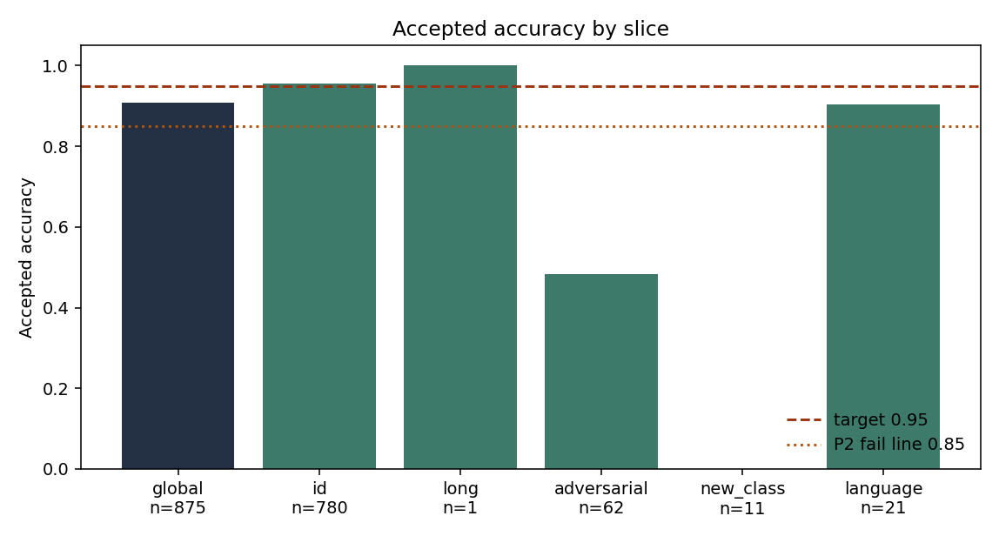
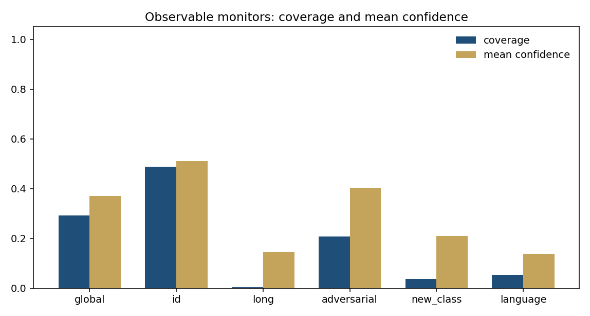
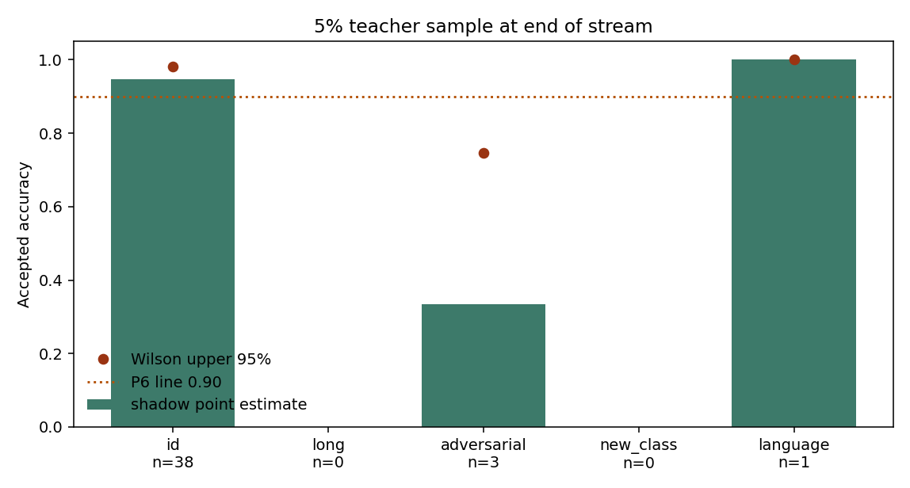
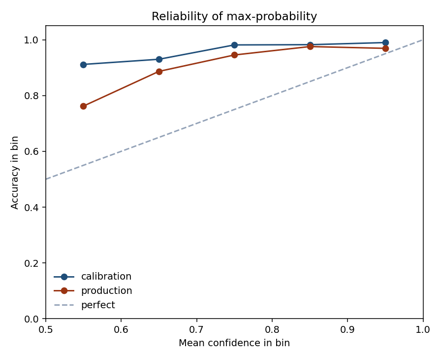

# M0 results

**Verdict: KILL.** Do not build M1.

The pre-registered claim was that a locked threshold would let accepted accuracy fall on a slice while global accuracy and global confidence still looked fine, and that a 2–5% teacher sample would be what caught it. The run does not support that conjunction.

Prediction commit: `bbe1d0bcdc8784d8da364aa7a7065b3d4b7a2246`. This file was written after that commit. The prediction text was not edited.

## Setup that actually ran

- Data: [AmazonScience/massive](https://huggingface.co/datasets/AmazonScience/massive) `en-US` and `es-ES`. Cooking intents were held out of fit and calibration.
- Decision model: word TF-IDF (1–2 grams) and L2 logistic regression, 58 intents, fit on 11,303 English training rows. Laya was not loaded. Base Laya is 0.362 zero-shot on typed-decisions, so a 0.95 gate would have escalated everything and the drift test would have been empty. See `docs/M0-predictions.md`.
- Teacher: **MASSIVE gold labels, not an LLM.** No OpenAI, Anthropic, or DeepSeek key was present. Gold is a quieter teacher than a model judge, so a miss here is not an excuse that the teacher was noisy.
- Locked threshold: **0.50**, status `primary`. On the 1,990-row calibration split this accepted 1,018 rows (coverage 0.512) at accuracy **0.961**. 0.50 is the bottom of the pre-registered grid. The probabilities are under-confident in domain: the most permissive allowed gate already cleared 0.95. A tighter gate was not required, and a looser one was not permitted.

Primary stream seed 42. Five extra seeds redraw the stream only.

## Prediction versus result

| Quantity | Frozen prediction | Primary result |
| --- | --- | --- |
| Verdict | KILL | **KILL** |
| Calibration coverage | 0.25–0.55 | 0.512 |
| `id` accepted accuracy | ≥ 0.95 | **0.955** (780 accepts) |
| Global accepted accuracy | 0.93–0.97 | **0.909** (875 accepts) |
| Worst slice | language or new class, by escalation | **adversarial**, by wrong accepts (0.484 on 62) |
| Global mean-confidence shift | ≤ 0.05 | **0.144** (0.516 → 0.371) |
| Global coverage shift | ≤ 0.10 to count as silent | **0.220** (0.512 → 0.292) |
| 5% shadow detects the bad slice by row 1,500 | no | **no** (1 shadow-accepted label) |

The verdict matched. Two metric ranges did not: global accepted accuracy landed below 0.93, and confidence moved much more than 0.05. Both misses make the failure louder, not more hidden. The adversarial prefix also hurt more than predicted (accepted accuracy 0.48, not “near the in-distribution slice”).

## What the slices did

| Slice | n | Coverage | Mean confidence | Raw accuracy | Accepted n | Accepted accuracy |
| --- | ---: | ---: | ---: | ---: | ---: | ---: |
| calibration | 1,990 | 0.512 | 0.516 | — | 1,018 | 0.961 |
| global production | 3,000 | 0.292 | 0.371 | 0.549 | 875 | 0.909 |
| id | 1,600 | 0.488 | 0.511 | 0.794 | 780 | 0.955 |
| long | 400 | 0.003 | 0.145 | 0.605 | 1 | 1.000 |
| adversarial | 300 | 0.207 | 0.404 | 0.240 | 62 | 0.484 |
| new_class | 300 | 0.037 | 0.209 | 0.000 | 11 | 0.000 |
| language | 400 | 0.053 | 0.137 | 0.153 | 21 | 0.905 |





Reading the three questions in the brief:

1. **Does accepted accuracy fall below 0.95 while confidence still looks fine?** Accuracy falls (0.909 global, 0.484 on the adversarial slice). Confidence does not look fine. Mean max-probability drops by 0.144 and the accept rate drops by 22 points. A monitor of those two global series, with no labels, would alarm. P4 fails.
2. **Does a bad slice hide inside a healthy global number?** No. Global accepted accuracy is already 0.909, under the 0.93 hiding line (P3). The adversarial slice is the one real leak (P2), and it is also obvious without a teacher: its accept rate is 0.207 against 0.488 in distribution, and its mean confidence is 0.107 lower (P5 fails). Spanish, boilerplate length, and the new cooking domain are mostly refused by the same threshold. Their raw accuracy is poor and their confidence collapses, which is the gate working.
3. **Does a 2–5% teacher sample catch it early?** No. At 5%, the adversarial slice has 1 teacher-checked accept by the midpoint and 3 by the end. The rule needed 15 and a Wilson upper bound under 0.90. At 2% it has 0 by the midpoint and 1 by the end. P6 fails on every sensitivity seed as well.





The reliability curve sits above the diagonal: when this model says 0.55 it is right about 90% of the time on calibration. Production is less under-confident in the low bin and still not over-confident. The failure mode in the brief is a model that stays sure while becoming wrong. This model becomes unsure.

## Gates

| Gate | Primary | Meaning |
| --- | --- | --- |
| P1 | pass | Calibration met 0.95 accuracy at ≥ 0.20 coverage |
| P2 | pass | Adversarial accepted accuracy 0.484 on 62 rows |
| P3 | fail | Global accepted accuracy 0.909 < 0.93 |
| P4 | fail | Confidence shift 0.144, coverage shift 0.220 |
| P5 | fail | The bad slice is already visible from its own coverage and confidence |
| P6 | fail | 5% shadow has 1 accepted label on that slice at mid-stream |
| P7 | fail | 0 of 5 sensitivity seeds pass P2–P5 |

Seeds 0–4 repeat the same pattern: adversarial accepted accuracy between 0.444 and 0.623, global accepted accuracy between 0.910 and 0.923, confidence shift about 0.14, coverage shift about 0.21. No seed hides the slice.

## What shadow sampling would have cost

Unit price is the assumed $0.002 per teacher call from the prediction file, not an invoice. The fast model is free. Escalating means paying the teacher.

| Policy | Teacher calls | Cost on 3,000 rows |
| --- | ---: | ---: |
| LLM on every row | 3,000 | $6.00 |
| Gate only (2,125 escalations) | 2,125 | $4.25 |
| Gate + 2% shadow | 2,185 | $4.37 |
| Gate + 5% shadow | 2,275 | $4.55 |

The gate saves about 29% versus labeling every row, because 875 decisions are accepted locally. Adding a 5% shadow sample costs an extra $0.30 and, on this stream, does not produce enough accepted checks on the bad slice to fire the detector. The signal that does fire — coverage and mean confidence — costs nothing.

## Why this kills M1

M1 was justified only if static thresholds fail silently and online per-slice teacher labels are what reveal the slice. Here the threshold holds on the English traffic it was fit on (accepted accuracy 0.955). On the drifted stream it misses the 0.95 target, but the miss is accompanied by a large, free movement in confidence and accept rate, including inside the bad slice. A 5% perfect teacher cannot see that slice early because the slice is small and mostly escalated.

That is a negative result for this control plane, not a proof that no decision model can ever be confidently wrong. An over-confident encoder could still leak. It is a proof that the pain is not automatic, and that shipping a teacher-sampling loop on the strength of the brief would be building ahead of the failure mode this protocol was able to produce.

## Reproduce

```bash
pip install -r requirements.txt
make m0
```

`make m0` runs `python3 -m experiments.m0.run_m0`. It downloads MASSIVE on first use, refits the classifier, and rewrites `docs/m0/metrics.json` and `docs/m0/figures/`. Seeds and quotas are in `experiments/m0/protocol.py`, which matches `docs/M0-predictions.md`.
