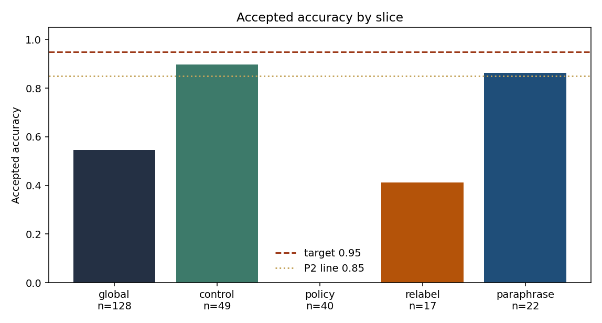
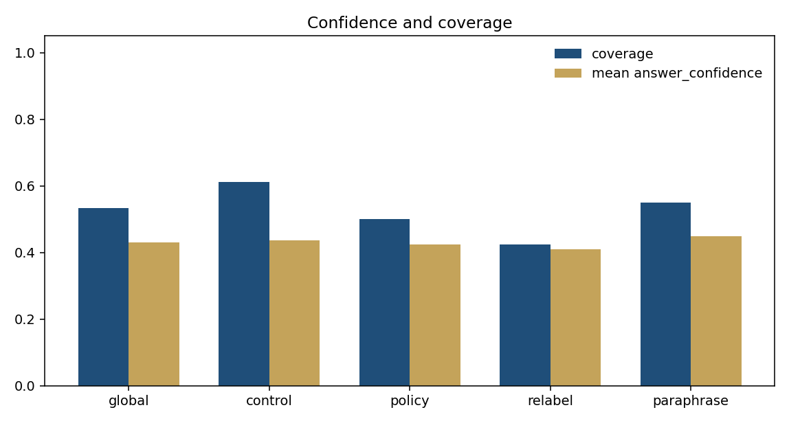
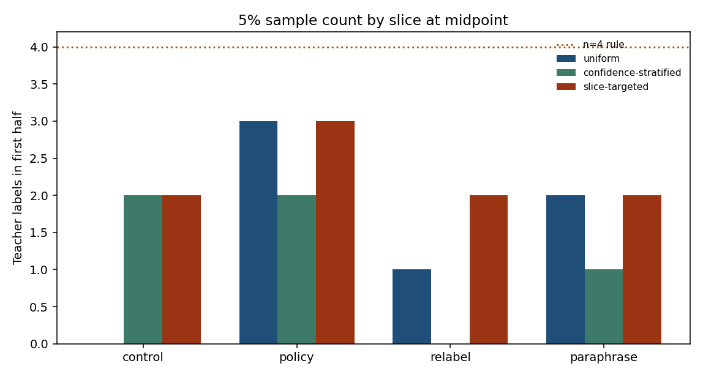
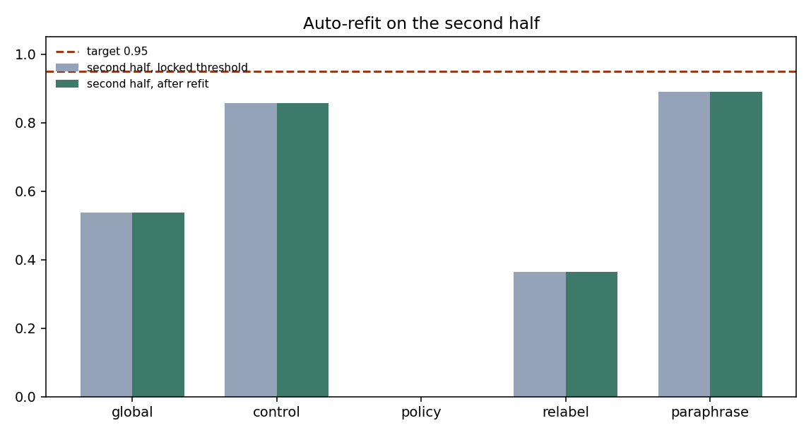

# M0b results

**Verdict: KILL.** Do not build the closed loop.

A label change on unchanged text does hide from confidence and coverage. A 5% teacher sample does not flag that slice by the midpoint, and the pre-registered refit therefore never runs. Escalating the bad slice by hand still would not put accepted accuracy back at 0.95, because the untouched slice is already below that.

Protocol that was scored: `097663b` (split arithmetic corrected before the run; gates from `fcb236a`). Predictions were not edited after the score.

## What ran

- Backend: `LayaBackend` on `convaiinnovations/laya-typed-decisions`, CPU, question `action`. 571 forward passes, about five minutes. `JEV_API_KEY` was unset, so the hosted pass was skipped.
- Teacher: gold `action__label`. No LLM key. Gold is an oracle.
- Locked threshold: **0.40**. On 60 calibration rows this accepts 33 (coverage 0.550) at accuracy **1.000**. Status `primary`. Mean `answer_confidence` on calibration is 0.437. The model is under-confident, and the top of the grid that still clears 0.95 is 0.40.

## Prediction versus result

| Quantity | Frozen prediction | Result |
| --- | --- | --- |
| Verdict | KILL | **KILL** |
| P1 calibration | uncertain | **pass** (0.40, coverage 0.550, accuracy 1.000) |
| Silent slice | `policy` | **yes.** Accepted accuracy **0.000** on 40 accepts. Confidence gap vs control 0.014. Coverage gap 0.113 |
| `relabel` | wrong, and too small to flag | Accepted accuracy 0.412 on **17** accepts. Below the n≥20 bar. Coverage gap vs control 0.188, so a coverage monitor would see it |
| `paraphrase` | near control, or a confidence drop | Accepted accuracy **0.864** (control 0.898). Mean confidence 0.448 vs control 0.438. Not a silent failure |
| P5, flag by row 120 | fail | **fail.** Uniform has 3 policy labels at the midpoint and first flags at row **151** |
| P6, refit restores 0.95 | fail | **fail.** No policy was eligible, so every threshold stayed 0.40. Second-half accepted accuracy **0.537** |
| P7, silent failure on 3 of 5 seeds | — | **4 of 5** |

The kill call matched. The mechanism matched on detection and refit. It did not match on `relabel`: that slice missed both the accept-count bar and the flat-coverage bar, so it was not a second hidden failure.

## The slice that confidence cannot see

| Slice | n | Coverage | Mean confidence | Top-1 accuracy | Accepted n | Accepted accuracy |
| --- | ---: | ---: | ---: | ---: | ---: | ---: |
| calibration | 60 | 0.550 | 0.437 | — | 33 | 1.000 |
| control | 80 | 0.613 | 0.438 | 0.800 | 49 | 0.898 |
| policy | 80 | 0.500 | 0.424 | 0.038 | 40 | 0.000 |
| relabel | 40 | 0.425 | 0.410 | 0.325 | 17 | 0.412 |
| paraphrase | 40 | 0.550 | 0.448 | 0.725 | 22 | 0.864 |
| global | 240 | 0.533 | 0.430 | 0.454 | 128 | 0.547 |

Global mean confidence moved by **0.007** and global coverage by **0.017**. Both are inside the flat band (0.05 and 0.10). Global accepted accuracy fell from 1.000 on calibration to **0.547**. That drop is invisible unless something checks labels.





`policy` is the same forward pass as any other original ticket, with the gold action cycled. The model still emits the old action at the old confidence. Forty of those decisions clear 0.40 and every one of them is wrong under the new policy. Per-slice confidence and coverage stay inside the band versus control, so a dashboard of those two series does not isolate the slice. This is the hidden failure M0 did not produce.

The official 100-row test split, scored at the same 0.40 and not used as a gate, has accepted accuracy **0.756**, coverage 0.450, mean confidence 0.401. The lock was fit on training rows the checkpoint has seen. It does not hold 0.95 on unseen tickets even before a policy change.

## Sampling

Budget is 5% of 240 rows. Detection needs at least 4 teacher labels on the slice and a one-sided 95% Wilson upper bound under 0.80.

| Policy | Calls | Cost at $0.002 | Policy labels by row 120 | First flag | Flags by the end |
| --- | ---: | ---: | ---: | --- | --- |
| uniform | 13 | $0.026 | 3 (all wrong, upper bound 0.47) | row 151 | yes, 5 labels |
| confidence-stratified | 12 | $0.024 | 2 | row 145 | yes, 5 labels |
| slice-targeted | 12 | $0.024 | 3 (upper bound 0.47) | never | no, stuck at 3 |



Labeling all 240 rows at the same unit price is $0.48. The 5% sample costs about five cents on this stream and does not fire inside the first half. Uniform and stratified would have fired just after the midpoint. The blocker at row 120 is the minimum of 4 labels: the Wilson bound on 0/3 was already 0.47. Slice-targeted spends its 12 draws evenly, so the large bad slice never collects 4 labels at all. Equal slice budgets are the wrong allocation when the broken slice is a third of the stream.

Laya itself costs $0 here. The teacher line is the assumed $0.002, not an invoice.

## Auto-refit

The refit is only allowed to use a policy that flagged by row 120. None did, so the second half is identical to the locked threshold.



Second half, threshold still 0.40:

| Slice | Accepted n | Accepted accuracy | Coverage |
| --- | ---: | ---: | ---: |
| global | 67 | 0.537 | 0.558 |
| control | 28 | 0.857 | 0.636 |
| policy | 19 | 0.000 | 0.543 |
| relabel | 11 | 0.364 | 0.478 |
| paraphrase | 9 | 0.889 | 0.500 |

A non-gated bound, using only those counts: if `policy` were fully escalated and everything else kept, accepted accuracy would be about 0.75. If both `policy` and `relabel` were escalated, the remainder is control plus paraphrase, about **0.86**. The restoration rule wants 0.95. Control alone on this half is 0.857, so no threshold on the poisoned slices can get the stream back to 0.95. The samples that do exist would not have supported a milder threshold either: the four uniform policy labels before row 151 are wrong at confidences 0.35, 0.41, 0.48, and 0.55, which sits on top of the accept region.

## Gates

| Gate | Result |
| --- | --- |
| P1 | pass |
| P2 | pass (`policy`, 0.000 on 40) |
| P3 | pass (shifts 0.007 and 0.017) |
| P4 | pass (gaps 0.014 and 0.113) |
| P5 | fail |
| P6 | fail |
| P7 | pass (4/5). Seed 0 misses flatness: coverage shift 0.121 |

## Why this is a final kill

The open question was whether hidden drift is real enough that a teacher-labeled per-slice error, followed by an automatic threshold change, is a new capability worth building. The first half is real: a policy relabel leaves confidence and coverage flat and drops accepted accuracy to zero on the slice. The second half is not. At a 5% budget the sample is one label short of the rule at the midpoint, slice-targeted never gets there, and putting the bad slice on escalation still leaves accepted accuracy under 0.95 because the clean slice is not at 0.95 either. That is a negative result for the closed loop.

## Reproduce

```bash
pip install -r requirements.txt
pip install torch==2.14.1 --index-url https://download.pytorch.org/whl/cpu
make m0b
```

`make m0b` runs `python3 -m experiments.m0b.run_m0b`. A cache of the 571 Laya outputs is in `docs/m0b/prediction-cache.json`. Delete it, or set `M0B_RECOMPUTE=1`, to call the model again. Metrics: `docs/m0b/metrics.json`.
